# CrucibleAI

### A multi-agent research system for materials discovery — plans, retrieves, reasons with tools, and **verifies its own claims**

Give CrucibleAI a goal in plain English:

> *Find solid-state electrolyte materials with ionic conductivity above 10⁻³ S/cm, electrochemical stability above 5 V, and no rare earth elements.*

A team of cooperating agents then plans the work, reads 1,234 materials-science papers, extracts property values with their
sources, cross-checks them against the Materials Project database, screens and ranks candidates, **goes looking for the evidence
that is missing**, proposes experiments, and finally **has a critic agent audit every hypothesis against the evidence it cites and
rewrite the ones it cannot support**. Everything is streamed live, traced, cached, evaluated, and exposed over a web API and an MCP
tool server.

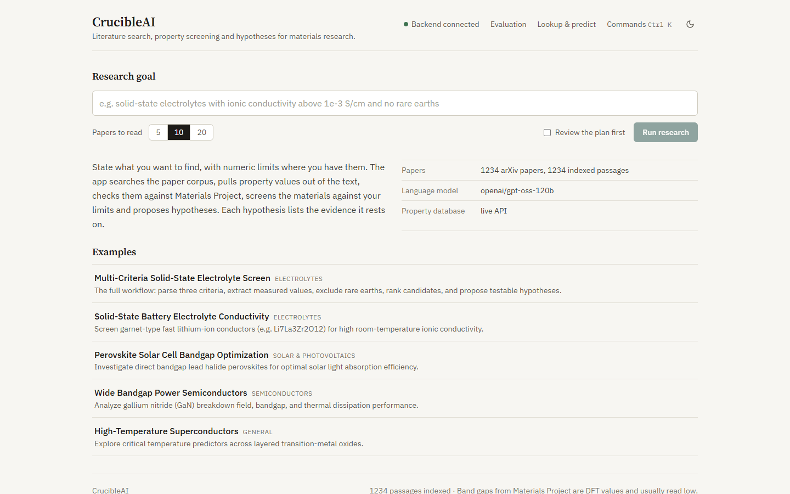

**Web UI:** [CrucibleAI-Frontend](https://github.com/im-rk/CrucibleAI-Frontend) ·
**Design:** [Architecture](docs/ARCHITECTURE.md) · [Design decisions](docs/DESIGN_DECISIONS.md) ·
**Measurements:** [Evaluation](docs/EVALUATION.md) · [Model card](docs/MODEL_CARD.md)

---

## Contents

1. [Why this is an agent system, not a RAG demo](#why-this-is-an-agent-system-not-a-rag-demo)
2. [The agent graph](#the-agent-graph)
3. [The agents](#the-agents)
4. [The agentic patterns used, and where](#the-agentic-patterns-used-and-where)
5. [Tool use: the Investigator](#tool-use-the-investigator)
6. [Self-verification: the Critic and Reviser](#self-verification-the-critic-and-reviser)
7. [Retrieval](#retrieval)
8. [The LLM runtime](#the-llm-runtime)
9. [Trust, safety and failure behaviour](#trust-safety-and-failure-behaviour)
10. [See it working](#see-it-working)
11. [Measured results](#measured-results)
12. [Interfaces: API, MCP, grounded Q&A](#interfaces-api-mcp-grounded-qa)
13. [Quick start](#quick-start)
14. [Layout, testing, deployment](#layout-testing-deployment)
15. [Honest limits](#honest-limits)

---

## Why this is an agent system, not a RAG demo

| Capability | What it does |
|---|---|
| **Plan, then execute** | A planner turns the goal into checkable criteria and searches. The user can edit that plan before anything runs (human in the loop) |
| **A tool-using agent** | The Investigator chooses its own literature searches, database lookups and ML estimates to find evidence for candidates that have none |
| **Evaluator–optimizer loop** | A critic checks every hypothesis against its cited evidence and sends weak ones back to be rewritten. One run went from grounding 0.10 to 0.70 |
| **Never invents** | Every value carries its source. ML estimates are labelled and **cannot** make a candidate qualify |
| **Degrades, never disappears** | Every agent has a rule-based path; the report says which path ran and why |
| **A production LLM runtime** | Response cache, token-per-minute scheduling, per-run call budget, exact token accounting, run traces, Prometheus metrics |
| **Prompt-injection defence** | Retrieved text is neutralised, fenced and never trusted with actions; attack success fell from 0.50 to 0.10 |
| **Measured, not asserted** | Retrieval, extraction, injection, end-to-end and model suites with a model card; results are shown in the UI |
| **Open interfaces** | Streaming web API, an MCP tool server, and grounded follow-up Q&A over a finished run |

---

## The agent graph

The pipeline is a **LangGraph state machine**. Following Anthropic's guidance on
[building effective agents](https://www.anthropic.com/research/building-effective-agents), it is a fixed *workflow* wherever the
path is known, and autonomy is added only where it cannot be known in advance (the Investigator). Every node is failure-isolated:
an agent that raises becomes a warning and the run continues with the state it has.

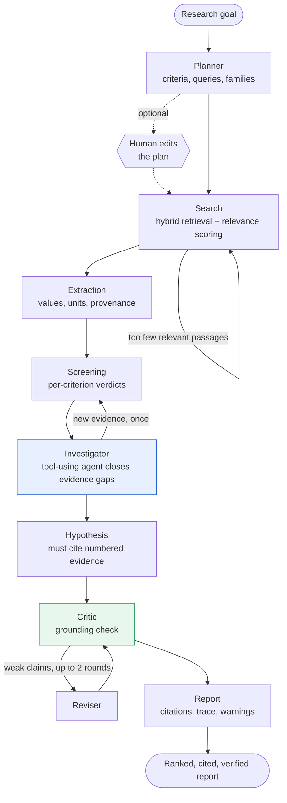

The shared state (`ResearchState`) is a typed dictionary; each node returns only the fields it adds, and `agent_log` and
`warnings` use an additive reducer so no agent can overwrite another's notes.

---

## The agents

| Agent | Does | Without an LLM |
|---|---|---|
| **Planner** | Goal → summary, numeric/element/evidence **criteria**, up to 5 literature queries, material families (one structured call). Drops invented requirements the goal never asked for | Regex criteria parser (`above 1e-3 S/cm`, `between 1.2 and 1.6 eV`, `no rare earth`, `cobalt-free`) and keyword queries |
| **Search** | Hybrid retrieval, then LLM relevance scoring in batches; **reformulates and retries** when results are weak (adds live arXiv abstracts on retry) | Heuristic relevance (cosine + keyword coverage) |
| **Extraction** | Passages → property records: material, formula, value, **unit-normalised** (13 properties), conditions, excerpt, source DOI; cross-checks the most-mentioned formulas against Materials Project | Regex extractor, always low confidence |
| **Screening** | Records + criteria → ranked candidates. ML estimates fill missing band gaps but **can never make a candidate qualify** | Same |
| **Investigator** | Candidates with no literature or a missing value → a **trajectory of tool calls** (`search_literature`, `lookup_material`, `predict_property`), then new values and one re-screen | One targeted search per candidate |
| **Hypothesis** | Candidates + numbered evidence (`E*` passages, `R*` records) → hypotheses that must cite evidence ids, a suggested experiment and a confidence; plus knowledge gaps | Template hypotheses, labelled as such |
| **Critic** | Each hypothesis vs the evidence it cites: deterministic rules **plus** an LLM judge; the stricter verdict wins | Rule checks only |
| **Reviser** | Weak hypotheses + the critic's reasons → narrower claims the evidence supports | Skipped |
| **Q&A** | A question about a finished run → a cited answer from that run's own evidence, with conversation memory | Best-matching passages |

---

## The agentic patterns used, and where

| Pattern | Where | Why it is there |
|---|---|---|
| **Plan-and-execute** (orchestrator) | Planner | One call turns a goal into checkable criteria and a search plan, shown to the user first |
| **Human in the loop** | Plan review | The user can drop a criterion or rewrite a query before any work is spent |
| **Routing / conditional loops** | Search retry, re-screen | The next step depends on how good the results were |
| **Tool-using agent (ReAct-style)** | Investigator | Which papers to look for, and with what words, cannot be scripted. Bounded to 6 steps, read-only tools |
| **Evaluator–optimizer** | Critic + Reviser | Hypotheses are where unsupported claims creep in; the loop is measured |
| **Parallelisation** | Batched relevance scoring and extraction | Independent passages are scored and read in groups under a concurrency cap |
| **Grounded generation** | Hypothesis, Q&A | Output must cite evidence ids that exist; citations are resolved against an index |
| **Memory** | Working state; finished-run store; the corpus | Working memory is the graph state, run memory powers follow-up Q&A, semantic memory is the paper corpus |
| **Guardrails** | Every place untrusted text meets a model | Neutralise, fence, constrain outputs, least-privilege tools |
| **Graceful degradation** | Every agent | A missing key or quota never produces a blank result |

---

## Tool use: the Investigator

After screening, some candidates have no literature behind them (they came from a database screen) or rest on a missing or
predicted value. The Investigator is the one agent that **decides its own actions**: it receives the task, picks a tool, reads the
observation, and decides what to do next until it has what it needs or runs out of steps.

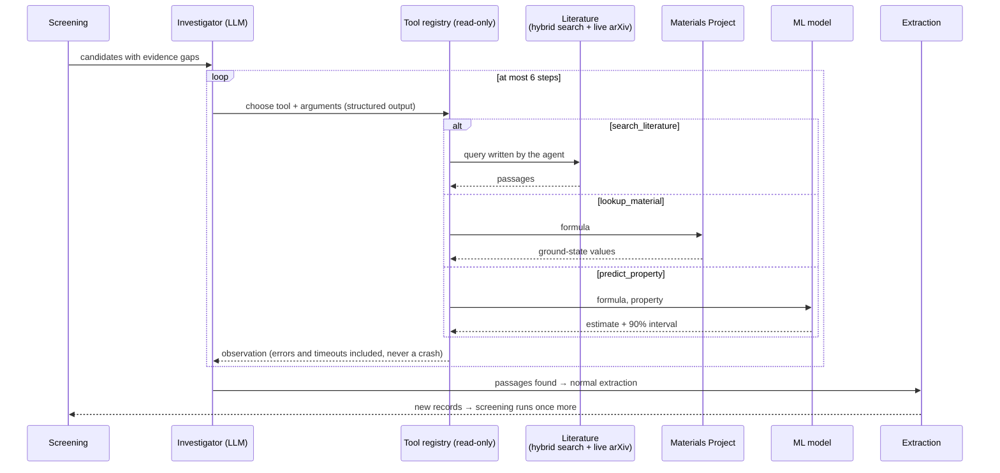

Design points: tools are **read-only** (nothing in a retrieved document can make the system act); a tool failure or timeout becomes
an observation the agent can react to; the loop is bounded; and the loop-back to screening happens **at most once**. Each tool call
is streamed to the UI as it happens.

---

## Self-verification: the Critic and Reviser

Hypotheses are the part of an LLM system most prone to unsupported claims, so the pipeline treats them as drafts to be audited.

1. **The Critic** checks every hypothesis against *only the evidence it cites*, using two independent judges and keeping the
   stricter verdict:
   - **Rules:** it must cite evidence, and every quoted figure (a number with a unit or a decimal point) must literally appear in the
     cited snippets.
   - **LLM judge:** `supported` / `partial` / `unsupported`, with a one-sentence reason.
2. If any model-written hypothesis is `partial` or `unsupported` and fewer than two revision rounds have run, **the Reviser** rewrites
   it into a narrower claim the evidence actually states, given the critic's reasons and the full evidence list.
3. The Critic runs again. The **grounding score per round** is recorded (supported = 1, partial = 0.5, unsupported = 0) and shown in
   the report, so you can see what the loop achieved.

---

## Retrieval

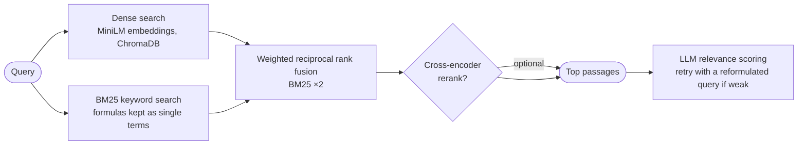

- **Corpus:** 1,234 arXiv abstracts (category `cond-mat.mtrl-sci`) from 26 topic queries — electrolytes, batteries, perovskites,
  wide-bandgap semiconductors, superconductors, thermoelectrics, 2D materials, MOFs, and materials-informatics. Each paper is one
  chunk, `"<Title>. <Abstract>"`, with title, first three authors, year and DOI kept.
- **Vector store:** ChromaDB (cosine, 384-dimensional `all-MiniLM-L6-v2` vectors); Pinecone is supported behind the same interface.
- **Why hybrid:** keyword search is excellent for formulas and exact terms, dense search for paraphrase. BM25 weighted ×2 beat equal
  weights on every task in the project's own benchmark ([EVALUATION](docs/EVALUATION.md)).
- **Beyond the corpus:** on a retry the Search agent also pulls live arXiv abstracts.

---

## The LLM runtime

Every model call from every agent goes through one wrapper, `InstrumentedLLM`, so no agent knows about providers or quotas. This is
what lets the system run on a **free-tier** model.

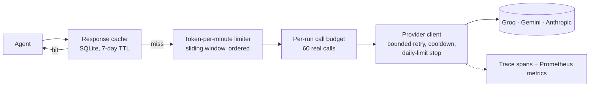

| Layer | What it does |
|---|---|
| **Cache** | Identical (provider, model, system, prompt, schema) calls are answered from SQLite. Repeating a goal replays in seconds; failures are never cached; evaluations become repeatable |
| **Token limiter** | Providers cap tokens per minute (Groq free tier ≈ 8,000). Calls reserve budget in a sliding window and *wait their turn* instead of failing; the wait shows in the trace as "scheduled, not failed" |
| **Budget** | At most 60 real calls per run, so a loop can never burn a quota |
| **Provider client** | Bounded retries (≤ 20 s waiting per call), then a three-minute cooldown so later steps go rule-based immediately; a daily-limit error stops the client with a stated reason |
| **Structured output** | Agents request Pydantic schemas; answers are validated, so malformed output is a handled failure, not a crash |
| **Accounting** | Exact token counts from the provider (estimates are marked), latency and outcome for every call |

**Observability.** Each run records a trace of spans — agent steps, model calls, retrievals, tool calls — in the style of
OpenTelemetry's GenAI spans. The report summarises it (calls, cache hits, tokens, rate-limit wait, time per agent) and the UI draws
the timeline. `GET /api/metrics` serves Prometheus text.

---

## Trust, safety and failure behaviour

**The design rule: never present something the system cannot back up.**

- **Provenance on everything.** Each value keeps its source title, DOI, arXiv id and the passage it came from. Database values are
  labelled `Materials Project (DFT)` or `offline reference`.
- **Estimates can't decide.** The band-gap model's output is always marked as predicted and yields `partial`, never `qualified`.
- **Citations must resolve.** A hypothesis can only cite evidence ids that exist in the run's evidence index.
- **Prompt-injection defence in depth** (papers are untrusted input — OWASP LLM01):
  1. instruction-like phrases are **neutralised** before reaching a prompt;
  2. untrusted passages are **fenced** in `<document>` blocks the system prompt names as data;
  3. outputs are **constrained** to schemas and existing evidence ids;
  4. tools are **read-only**.
  A planted false *fact* is data poisoning rather than instruction hijacking; that is the job of provenance, database cross-checks and
  the critic, not prompt hygiene.

| Condition | Behaviour |
|---|---|
| No LLM key, no credits, provider overloaded | Rule-based mode for the affected steps; the run banner and warnings say which and why |
| Daily quota exhausted | The client stops immediately with the reason; no retry storm |
| Per-minute token cap | Calls are scheduled around it |
| Materials Project unavailable | A small labelled table of experimental band gaps; unknown formulas return nothing |
| arXiv slow or rate-limited | Local corpus only, with a warning |
| PostgreSQL down | Runs complete but are not saved; `/api/sessions` answers 503 |
| One agent crashes | Recorded as a warning; the pipeline continues |
| Run exceeds its time limit | Reported as a timeout, never a hang |

---

## See it working

Screenshots from a live run of the UI against this backend.

### 1. Plan, then confirm
The planner shows the criteria it parsed and the searches it intends to run. Untick a criterion or rewrite a query; the edited plan
overrides the planner.

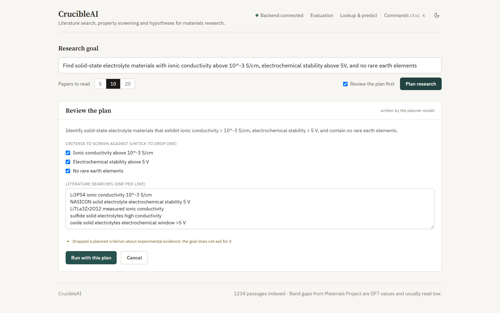

### 2. Watch the eight stages run
Plan → Literature search → Extract values → Screen candidates → Investigate gaps → Hypotheses → Verify and revise → Report, with a
running log (including the Investigator's tool calls) and a **Stop** button that cancels the run server-side.

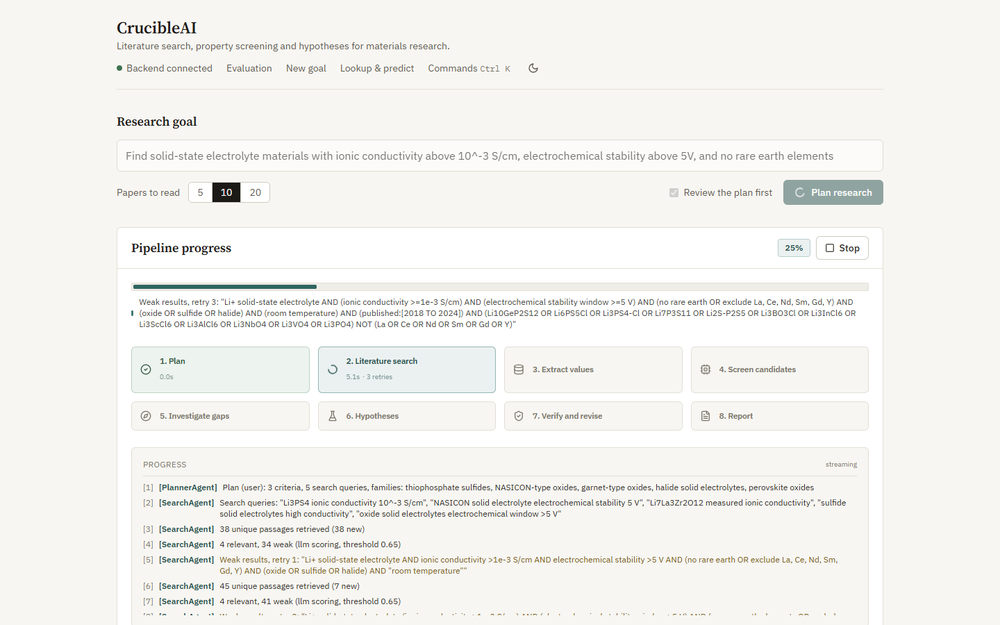

### 3. The report
Run-mode banner (which model, live or offline data), the plan that was used, ranked candidates, hypotheses with the critic's grounding
result, and the evidence gaps the Investigator worked on.

In this live run (Groq `openai/gpt-oss-120b`, live Materials Project, about 3 minutes on a free tier) the critic's grounding score went
**0.30 → 0.80 → 0.70** over two rewrite rounds, four of five hypotheses were marked *rewritten after critique*, and one was flagged
**"not supported by its evidence"** instead of being passed off as fact. The Investigator ran six tool calls and honestly reported that
it found **no new values**: neither candidate qualified, and the report says so.

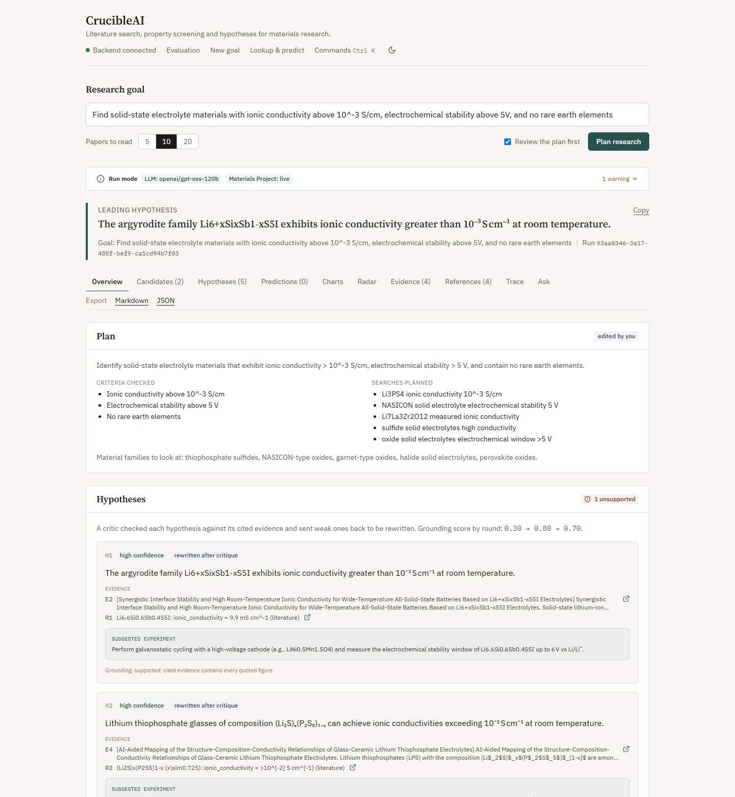

[Full-length report page](docs/images/05b_report_full.png)

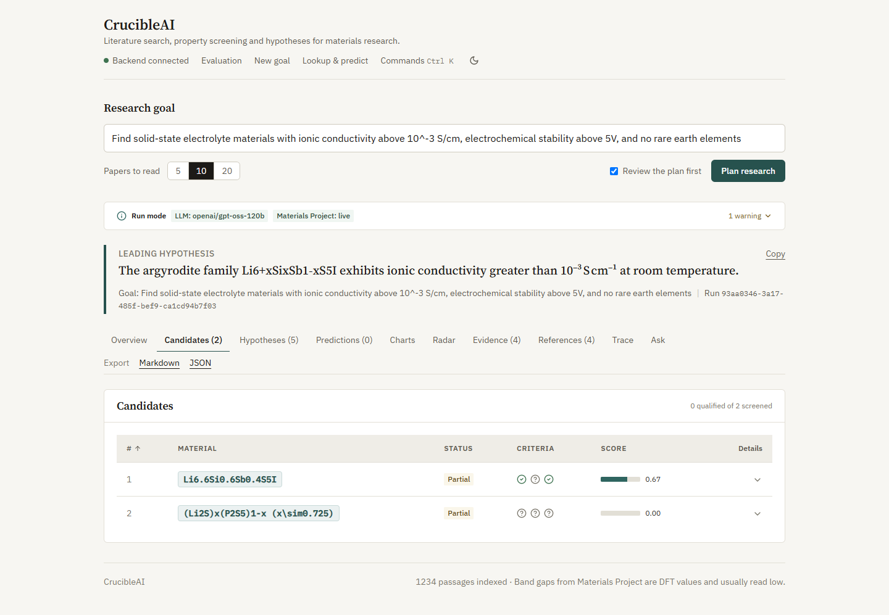

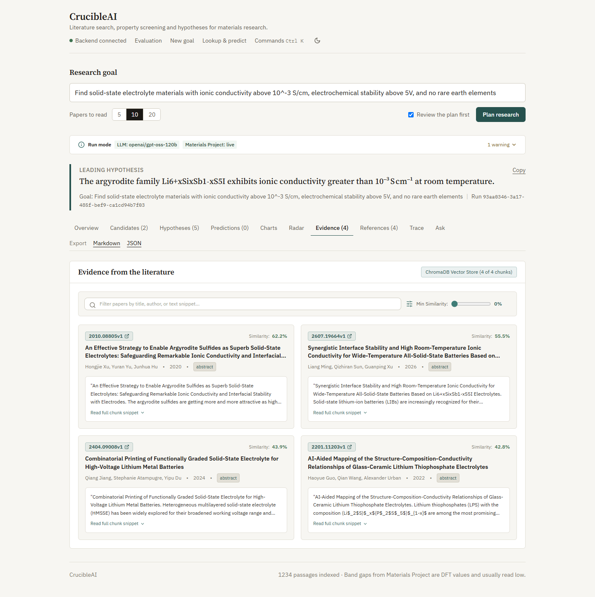

### 4. See what the run cost
Model calls and cache hits, tokens, time spent waiting on a provider rate limit, time per agent and a timeline of every model call,
retrieval and tool call.

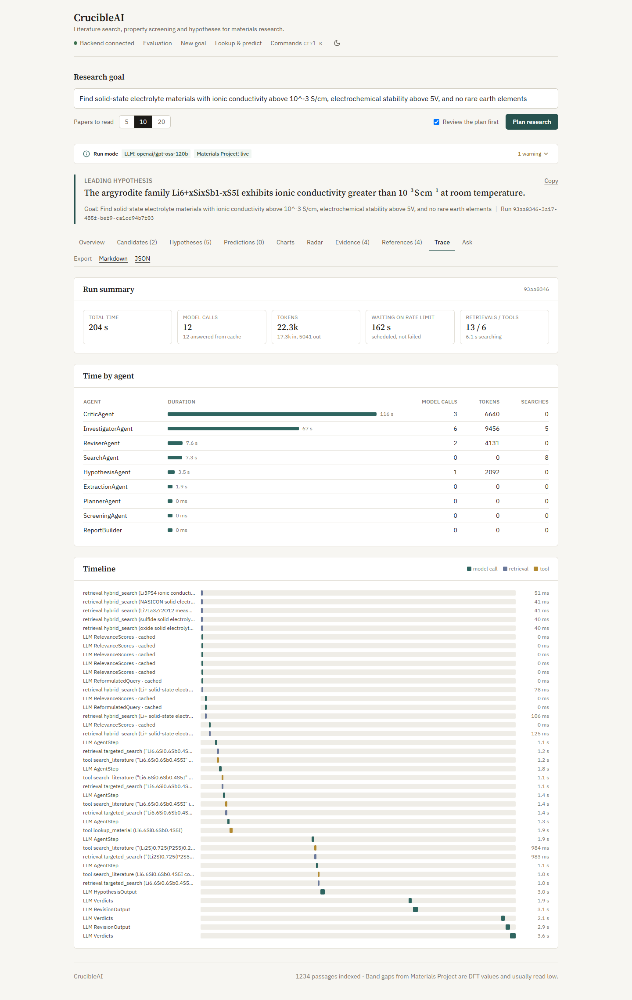

### 5. Ask follow-up questions
Answers come only from the finished run's own evidence, with citations.

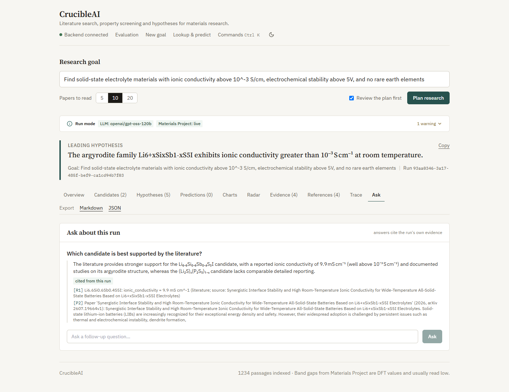

### 6. Measured quality, in the app
The backend's evaluation results are served to the UI.

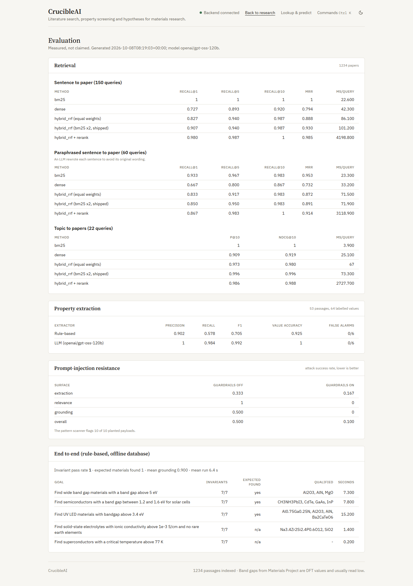

---

## Measured results

Details and method in [docs/EVALUATION.md](docs/EVALUATION.md).

| Area | Result |
|---|---|
| Corpus | 1,234 arXiv materials-science abstracts from 26 topic queries (title, authors, year, DOI kept) |
| Retrieval, sentence → paper (150 queries) | Hybrid with BM25 ×2: Recall@1 **0.91**, MRR **0.93** (equal weights: 0.83 / 0.89) |
| Retrieval, topic → papers (22 queries) | P@10 **0.996** |
| Property extraction (64 labelled values) | LLM: precision 1.00, recall 0.98, **F1 0.99** · rule-based fallback: precision 0.90, recall 0.58, F1 0.71 |
| Prompt injection (3 surfaces) | Attack success **0.50 without guardrails → 0.10 with** |
| End to end (5 goals, 35 invariant checks) | **35/35 hold**: a qualified candidate really meets its numeric criteria, excluded elements never appear, an estimate never decides a verdict, every cited id resolves |
| Band-gap model (1,500 materials) | R² **0.73** (Laplacian-kernel KRR), level with the best of six baselines; the 90% conformal interval covers **90.0%** of unseen materials |

These suites are small. They are regression guards and honest comparisons, not published benchmarks.

---

## Interfaces: API, MCP, grounded Q&A

| Endpoint | Purpose |
|---|---|
| `POST /api/research/stream` | Run the pipeline, streaming progress as Server-Sent Events; the last event carries the report |
| `POST /api/research` | Same, returning the finished report |
| `POST /api/research/plan` | The plan only, for review; send it back as `plan` to run it |
| `POST /api/runs/{id}/ask` | Follow-up question about a finished run, answered with citations |
| `GET /api/materials/lookup`, `/materials/screen`, `POST /api/predict` | Materials Project (or the offline table), and the ML estimate with its 90% interval |
| `GET /api/papers`, `/papers/{id}`, `/corpus` | Browse the corpus |
| `GET /api/sessions`, `/sessions/{id}` | Saved runs (needs PostgreSQL) |
| `GET /api/evaluation/latest`, `GET /api/metrics` | Evaluation results; Prometheus metrics |
| `GET /api/health` | What is actually running |

Stream events: `session_started`, `plan_ready`, `agent_start` / `agent_complete`, `queries_generated`, `re_retrieving`,
`relevance_check`, `properties_extracted`, `candidates_found`, `tool_call`, `investigation_done`, `hypotheses_generated`,
`grounding_check` (with the round), `hypotheses_revised`, then `complete` (the report) or `error`.

### MCP server

```bash
python -m matsci_agent.mcp          # JSON-RPC 2.0 over stdio
```

Tools: `search_literature`, `lookup_material`, `predict_property`, `screen_materials`, `plan_research`, `run_research`. Register it in
an MCP client such as Claude Desktop:

```json
{ "mcpServers": { "crucibleai": { "command": "python", "args": ["-m", "matsci_agent.mcp"], "cwd": "<path to this repo>" } } }
```

### Grounded follow-up Q&A

After a run finishes, ask about it. The Q&A agent sees only that run's report (evidence, records, hypotheses) plus the last few turns
of the conversation, and must cite evidence ids; without an LLM it returns the best-matching passages.

---

## Quick start

Requires Python 3.11+, [uv](https://docs.astral.sh/uv/) and Node 18+ (for the UI).

```bash
# backend
uv sync --extra dev
cp .env.example .env                  # add keys if you have them; every one is optional
python scripts/verify_setup.py        # checks corpus, embedding model, keys, database, arXiv
uv run uvicorn matsci_agent.api.server:app --port 8000        # API docs at http://localhost:8000/docs

# frontend (in the CrucibleAI-Frontend repo)
npm install
npm run dev                           # http://localhost:3000

# or run once from the command line
python scripts/run_research.py --query "Find UV LED materials with bandgap above 3.4 eV"
```

### Keys (all optional)

| Variable | Unlocks |
|---|---|
| `GROQ_API_KEY`, `GEMINI_API_KEY` or `ANTHROPIC_API_KEY` | The LLM steps (`LLM_PROVIDER=groq\|gemini\|anthropic\|auto`) |
| `MATERIALS_PROJECT_API_KEY` | Live database values (otherwise a small labelled table of experimental band gaps) |
| `PINECONE_API_KEY` | Managed vector store (`VECTOR_STORE=pinecone`) |

Without any key the pipeline still runs, in a degraded mode that the report, `/api/health` and the UI state plainly. On a free LLM
tier set `LLM_TOKENS_PER_MINUTE` (Groq: 7000) and `LLM_CONCURRENCY=2`; the runtime schedules calls around the cap. **A first run on a
free tier takes minutes; repeating a goal replays from the cache in seconds**, so run your demo goal once beforehand.

### Rebuild the corpus

```bash
python scripts/build_corpus.py --reset --per-topic 60     # about 10 minutes, mostly arXiv rate limits; abstracts are cached
```

### Run the evaluations

```bash
python scripts/run_evals.py --suite retrieval,extraction          # no LLM needed for the rule-based rows
python scripts/run_evals.py --suite injection,e2e                 # needs an LLM key for injection
python scripts/run_evals.py --suite e2e --e2e-llm --cases 2       # whole pipeline with the model (slow on a free tier)
python scripts/benchmark_models.py                                # band-gap model vs baselines; calibration; docs/MODEL_CARD.md
```

---

## Layout, testing, deployment

```
src/matsci_agent/
  agents/            LangGraph graph; nodes: planner, search, extraction, screening, investigator, hypothesis, critic, qa, report;
                     tools.py and toolloop.py (the bounded tool loop)
  infrastructure/    llm/ (Anthropic, Gemini, Groq clients; InstrumentedLLM; cache; rate limiter), retrieval/, vector_store/,
                     clients/ (arXiv, Materials Project), ml/ (kernel ridge regression), db/
  observability/     per-run traces and Prometheus metrics
  security/          prompt-injection guardrails
  evaluation/        retrieval, extraction, injection, end-to-end and model benchmarks; suite runner
  corpus/            topic list and corpus builder
  mcp/               MCP server
  services/          research service (streaming), grounding, report builder, persistence, report store
  api/               FastAPI app and routers
scripts/             build_corpus, run_evals, benchmark_models, run_research, verify_setup, train_krr, migrate_to_pinecone
docs/                ARCHITECTURE, DESIGN_DECISIONS, EVALUATION, MODEL_CARD, images/
tests/               unit and integration (incl. a stdio test of the MCP server and an end-to-end run of the real graph)
```

```bash
uv run pytest -q        # about 380 tests; no network or keys needed
uv run ruff check --select F,E9 src tests scripts
```

CI runs lint, the migrations (`alembic upgrade head` and `alembic check`) and the suite against a real PostgreSQL.

```bash
docker compose up --build                        # API + PostgreSQL
docker compose --profile full up --build         # also the web UI on :8080 (needs ../CrucibleAI-Frontend)
```

The locked dependencies include PyTorch with CUDA libraries, so the image is several GB and the first build is slow (a CPU-only
PyTorch wheel is the fix for a CPU server). On AWS EC2 start with a `t3.medium`, set `CORS_ORIGINS` to the UI's origin, and put a TLS
proxy with a long read timeout in front; the bundled nginx already disables response buffering for the SSE endpoint. The Docker build
with the current Dockerfile has not been verified end to end.

---

## Honest limits

- **Abstracts only.** Values that appear only in tables or supplementary data are never read.
- **A small corpus.** Goals outside its 26 topics (for example superconductors above 77 K) return no qualifying candidates; the system
  says so rather than inventing some.
- **The band-gap model predicts the PBE-DFT gap,** which underestimates measured gaps (GaN: about 1.6 eV estimated, 1.74 eV in
  Materials Project, 3.4 eV measured). Its 90% interval is about 2.8 eV wide: use it for triage. It can never make a candidate qualify.
- **Free LLM tiers are small:** Gemini allows about 20 requests a day per model, Groq about 8,000 tokens a minute. The runtime stops on
  a daily limit, schedules around a per-minute one and pauses after a temporary failure; the report always says what happened.
- **Evaluation sets are small** (64 labelled values, 22 topic queries, 5 end-to-end goals): regression guards, not benchmarks.
- HTTPS is verified against the operating system's certificate store (`USE_SYSTEM_CERTS=true`), which fixes
  `CERTIFICATE_VERIFY_FAILED` behind TLS-inspecting proxies without disabling verification.
- Materials Project values use the ground state of each formula; the database seed considers experimentally known, non-radioactive
  structures only.

Design documents behind the original plan: [`01_README.md`](docs/01_README.md), [`02_SETUP_GUIDE.md`](docs/02_SETUP_GUIDE.md),
[`03_IMPLEMENTATION_PLAN.md`](docs/03_IMPLEMENTATION_PLAN.md), [`MaterialsResearchAgent_PRD.md`](docs/MaterialsResearchAgent_PRD.md).
