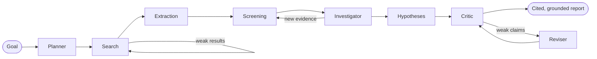

# CrucibleAI

**An autonomous research assistant for materials discovery.** Give it a goal in plain English, such as
*"find solid-state electrolytes with ionic conductivity above 10⁻³ S/cm, electrochemical stability above 5 V and no rare earth
elements"*. It plans the work, reads 1,234 materials-science papers, extracts property values with their sources, cross-checks them
against Materials Project, screens candidates, goes looking for missing evidence, proposes hypotheses, and then **checks and
rewrites its own claims against the evidence it cites**. Every step is traced, cached, evaluated, and exposed over a web API and an
MCP tool server.

Web UI: [CrucibleAI-Frontend](https://github.com/im-rk/CrucibleAI-Frontend) · Design: [docs/ARCHITECTURE.md](docs/ARCHITECTURE.md),
[docs/DESIGN_DECISIONS.md](docs/DESIGN_DECISIONS.md) · Measurements: [docs/EVALUATION.md](docs/EVALUATION.md),
[docs/MODEL_CARD.md](docs/MODEL_CARD.md)



## What makes it more than a RAG demo

| Capability | What it does |
|---|---|
| **Plan, then execute** | A planner turns the goal into criteria, searches and material families; the user can edit the plan before anything runs |
| **A tool-using agent** | The Investigator chooses its own literature searches, database lookups and ML estimates to find evidence for candidates that have none |
| **Self-verification** | A critic checks every hypothesis against its cited evidence and sends weak ones back to be rewritten; one run went from grounding 0.10 to 0.70 |
| **Never invents** | Values carry their source; ML estimates are labelled and cannot make a candidate qualify; every agent has a rule-based path and the report says which was used |
| **An LLM runtime** | Response cache, token-per-minute scheduling, per-run call budget, exact token accounting, per-run trace, Prometheus metrics |
| **Prompt-injection defence** | Retrieved text is neutralised, fenced and never trusted with actions; attack success fell from 0.50 to 0.10 |
| **Measured quality** | Retrieval, extraction, injection and end-to-end suites, plus a model card with calibrated intervals |
| **MCP server** | The same capabilities as tools for any MCP client |
| **Grounded follow-up Q&A** | Ask about a finished run; answers cite only that run's own evidence |

## Results (details and method in `docs/`)

| Area | Result |
|---|---|
| Corpus | 1,234 arXiv materials-science abstracts from 26 topic queries (title, authors, year, DOI kept) |
| Retrieval, sentence to paper (150 queries) | BM25 weighted ×2 in the hybrid: Recall@1 0.91, MRR 0.93 (equal weights: 0.83 / 0.89) |
| Property extraction (64 labelled values) | LLM: precision 1.00, recall 0.98 (F1 0.99) · rule-based fallback: precision 0.90, recall 0.58 (F1 0.71) |
| Prompt injection (3 surfaces) | Attack success 0.50 without guardrails, 0.10 with |
| End to end (5 goals, 35 invariant checks) | 100% of invariants hold; qualifying candidates returned for every band-gap goal |
| Band-gap model (1,500 materials) | R² 0.728 (Laplacian-kernel KRR), level with the best of six baselines; 90% conformal interval covers 90.0% of unseen materials |

These suites are small. They are regression guards and honest comparisons, not published benchmarks; limits are listed in
[docs/ARCHITECTURE.md](docs/ARCHITECTURE.md#honest-limits).

## Quick start

Requires Python 3.11+ and [uv](https://docs.astral.sh/uv/).

```bash
uv sync --extra dev
cp .env.example .env                  # add keys if you have them; every one is optional
python scripts/verify_setup.py        # checks corpus, embedding model, keys, database, arXiv
uvicorn matsci_agent.api.server:app --reload --port 8000        # docs at /docs
python scripts/run_research.py --query "Find UV LED materials with bandgap above 3.4 eV"
```

### Keys (all optional)

| Variable | Unlocks |
|---|---|
| `GROQ_API_KEY`, `GEMINI_API_KEY` or `ANTHROPIC_API_KEY` | The LLM steps (`LLM_PROVIDER=groq\|gemini\|anthropic\|auto`) |
| `MATERIALS_PROJECT_API_KEY` | Live database values (otherwise a small labelled table of experimental band gaps) |
| `PINECONE_API_KEY` | Managed vector store (`VECTOR_STORE=pinecone`) |

Without any key the pipeline still runs, in a degraded mode that the report, `/api/health` and the UI state plainly.
On a free LLM tier set `LLM_TOKENS_PER_MINUTE` (Groq: 7000) and `LLM_CONCURRENCY=2`; the runtime schedules calls around the cap.
A rate-limited run takes minutes; repeating a goal replays from the cache in seconds.

### Rebuild the corpus

```bash
python scripts/build_corpus.py --reset --per-topic 60     # about 10 minutes, mostly arXiv rate limits; abstracts are cached
```

## API

| Endpoint | Purpose |
|---|---|
| `POST /api/research/stream` | Run the pipeline, streaming progress as Server-Sent Events; the last event carries the report |
| `POST /api/research` | Same, returning the finished report |
| `POST /api/research/plan` | The plan only (criteria, queries, families), for review; send it back as `plan` to run it |
| `POST /api/runs/{id}/ask` | Follow-up question about a finished run, answered with citations |
| `GET /api/materials/lookup`, `/materials/screen`, `POST /api/predict` | Materials Project (or the offline table), and the ML estimate with its 90% interval |
| `GET /api/papers`, `/papers/{id}`, `/corpus` | Browse the corpus |
| `GET /api/sessions`, `/sessions/{id}` | Saved runs (needs PostgreSQL) |
| `GET /api/evaluation/latest`, `GET /api/metrics` | Evaluation results; Prometheus metrics |
| `GET /api/health` | What is actually running |

Stream events include `plan_ready`, `tool_call`, `investigation_done`, `grounding_check` (with the round) and
`hypotheses_revised`, alongside the per-agent `agent_start` / `agent_complete`.

## MCP server

```bash
python -m matsci_agent.mcp          # JSON-RPC 2.0 over stdio
```

Tools: `search_literature`, `lookup_material`, `predict_property`, `screen_materials`, `plan_research`, `run_research`. Register it
in an MCP client such as Claude Desktop:

```json
{ "mcpServers": { "crucibleai": { "command": "python", "args": ["-m", "matsci_agent.mcp"], "cwd": "<path to this repo>" } } }
```

## Evaluation

```bash
python scripts/run_evals.py --suite retrieval,extraction          # no LLM needed for the rule-based rows
python scripts/run_evals.py --suite injection,e2e                 # needs an LLM key for injection
python scripts/run_evals.py --suite e2e --e2e-llm --cases 2       # whole pipeline with the model (slow on a free tier)
python scripts/benchmark_models.py                                # band-gap model vs baselines; calibration; docs/MODEL_CARD.md
```

Results are written to `evaluation/results/` and rendered into `docs/EVALUATION.md`; the UI shows them under *Evaluation*.

## Layout

```
src/matsci_agent/
  agents/            LangGraph graph; nodes: planner, search, extraction, screening, investigator, hypothesis, critic, qa, report;
                     tools.py and toolloop.py (the bounded tool loop)
  infrastructure/    llm/ (Anthropic, Gemini, Groq clients; InstrumentedLLM; cache; rate limiter), retrieval/, vector_store/,
                     clients/ (arXiv, Materials Project), ml/ (kernel ridge regression), db/
  observability/     per-run traces and Prometheus metrics
  security/          prompt-injection guardrails
  evaluation/        retrieval, extraction, injection, end-to-end and model benchmarks; suite runner
  corpus/            topic list and corpus builder
  mcp/               MCP server
  services/          research service (streaming), grounding, report builder, persistence, report store
  api/               FastAPI app and routers
scripts/             build_corpus, run_evals, benchmark_models, run_research, verify_setup, train_krr, migrate_to_pinecone
docs/                ARCHITECTURE, DESIGN_DECISIONS, EVALUATION, MODEL_CARD
tests/               unit and integration (incl. a stdio test of the MCP server and an end-to-end run of the real graph)
```

## Testing

```bash
uv run pytest -q        # about 370 tests; no network or keys needed
uv run ruff check --select F,E9 src tests scripts
```

CI runs lint, the migrations (`alembic upgrade head` and `alembic check`) and the suite against a real PostgreSQL.

## Docker and deployment

```bash
docker compose up --build                        # API + PostgreSQL
docker compose --profile full up --build         # also the web UI on :8080 (needs ../CrucibleAI-Frontend)
```

The locked dependencies include PyTorch with CUDA libraries, so the image is several GB and the first build is slow. The corpus, models,
papers and embedding cache are volumes. For a CPU-only server, install a CPU-only PyTorch wheel instead. On AWS EC2 start with a
`t3.medium` (a 1 GB instance is likely too small for PyTorch plus the embedding model; not measured), set `CORS_ORIGINS` to the UI's origin,
and put a TLS proxy with a long read timeout in front; the bundled nginx already disables response buffering for the SSE endpoint.

## Notes and limits

- The band-gap model predicts the **PBE-DFT** gap, which underestimates measured gaps (GaN: about 1.6 eV estimated, 1.74 eV in Materials Project,
  3.4 eV measured). Its 90% interval is about 2.8 eV wide: use it for triage. It can never make a candidate qualify.
- The corpus is abstracts only; table and supplementary values are not read.
- Free LLM tiers are small: Gemini allows about 20 requests a day per model, Groq about 8,000 tokens a minute. The runtime stops on a daily limit,
  schedules around a per-minute one, and pauses after a temporary failure instead of stalling; the report always says what happened.
- HTTPS is verified against the operating system's certificate store (`USE_SYSTEM_CERTS=true`), which fixes `CERTIFICATE_VERIFY_FAILED` behind
  TLS-inspecting proxies or antivirus without disabling verification.
- Materials Project values use the ground state of each formula; the database seed considers experimentally known, non-radioactive structures only.

Design documents behind the original plan: [`01_README.md`](01_README.md), [`02_SETUP_GUIDE.md`](02_SETUP_GUIDE.md),
[`03_IMPLEMENTATION_PLAN.md`](03_IMPLEMENTATION_PLAN.md), [`MaterialsResearchAgent_PRD.md`](MaterialsResearchAgent_PRD.md).
