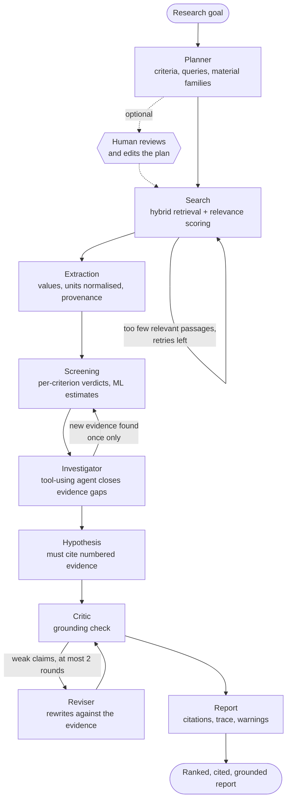
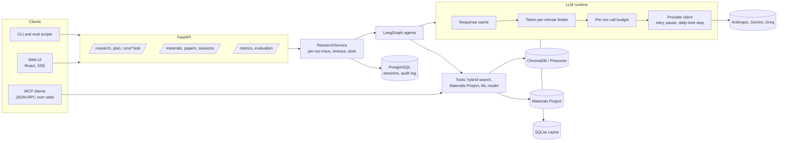

# Architecture

CrucibleAI is an autonomous research assistant for materials discovery. A researcher states a goal in plain
English; the system plans the work, reads the literature, extracts property values, cross-checks them against a
materials database, screens candidates, goes looking for missing evidence, proposes hypotheses, and then
**checks and rewrites its own claims against the evidence it cites**. Everything is traced, cached, rate-limited,
evaluated and exposed both as a web API and as an MCP tool server.

The design rule that shapes everything: **never present something the system cannot back up.** Values carry their
source, estimates are labelled and cannot decide a verdict, every service is optional, and when something is
unavailable the report says so.

## The agent graph



It is a LangGraph state machine, not a free-running agent. Following Anthropic's guidance on
[building effective agents](https://www.anthropic.com/research/building-effective-agents), the fixed pipeline is a
*workflow* and autonomy is added only where the path cannot be known in advance:

| Pattern | Where | Why it is there |
|---|---|---|
| Plan and execute (orchestrator) | Planner | One call turns a goal into checkable criteria and a search plan, shown to the user before work starts |
| Routing / looping on a condition | Search retry, re-screen | The next step depends on how good the results were |
| **Agent** (model chooses its own tool calls) | Investigator | Which papers to search for, and with what words, cannot be scripted; bounded to 6 steps |
| Evaluator-optimizer | Critic + Reviser | Hypotheses are the part most prone to unsupported claims; measured below |
| Human in the loop | Plan review | The user can drop a criterion or rewrite a query before anything runs |
| Parallelisation | Batched relevance scoring and extraction | Independent passages are scored and read in groups |

Every node is failure-isolated: an agent that raises becomes a warning and the run continues with what it has.

## What each agent does

| Agent | Input to output | Without an LLM |
|---|---|---|
| **Planner** | goal to summary, criteria, queries, material families (one structured call) | regex criteria parser and keyword queries |
| **Search** | queries to relevance-scored passages; reformulates and retries when results are weak; live arXiv fallback | heuristic relevance |
| **Extraction** | passages to property records with unit normalisation and the passage each came from; Materials Project cross-check | regex extractor, low confidence |
| **Screening** | records and criteria to ranked candidates; ML estimates fill missing band gaps but **can never make a candidate qualify**; database seed when the literature cannot supply enough qualifying materials | same |
| **Investigator** | candidates with no literature or a missing value, to a trajectory of tool calls (`search_literature`, `lookup_material`, `predict_property`), then new values and a re-screen | one targeted search per candidate |
| **Hypothesis** | screened candidates and numbered evidence to hypotheses that cite it, plus knowledge gaps | template hypotheses, labelled as such |
| **Critic** | each hypothesis against its cited evidence (rules plus an LLM judge, the stricter verdict wins) | rule checks only |
| **Reviser** | hypotheses the critic found weak, with the critic's reasons, to narrower claims the evidence supports | skipped |
| **Q&A** | a question about a finished run to a cited answer from that run's own evidence, with conversation memory | best-matching passages |

## Layers



### LLM runtime (the part that makes it run on a free tier)

All model calls go through `InstrumentedLLM`, so no agent knows about providers or quotas:

1. **Cache.** Identical (provider, model, prompt, schema) calls are answered from a local SQLite file. It saved most of the
   quota during development, makes evaluations repeatable, and turns a rehearsed demo into an instant replay.
   A rerun of an unchanged goal made 3 real calls and answered 21 from cache.
2. **Token limiter.** Providers cap tokens per minute (Groq's free tier: 8,000). Calls reserve budget in a sliding window
   and wait their turn instead of failing; the wait is shown in the trace as "scheduled, not failed".
3. **Budget.** At most 60 real calls per run, so a loop cannot burn a quota.
4. **Provider client.** Bounded retries (at most 20 s of waiting per call), then a three-minute pause so later steps use
   rules at once instead of repeating the same waits; a daily-limit error stops the client with a stated reason.
   An earlier version let every step repeat the full retry wait and a run died at the 300 s limit.
5. **Accounting.** Exact token counts from the provider (an estimate otherwise, marked as such), latency, outcome.

### Observability

Each run records a trace of spans (agent steps, model calls, retrievals, tool calls) in the style of OpenTelemetry's
GenAI spans, summarised into the report and shown in the UI: calls, cache hits, tokens, rate-limit wait, time per
agent, and a timeline. `GET /api/metrics` serves Prometheus text (runs by outcome, model calls and tokens by model
and agent, latency).

### Memory

- **Working memory**: the LangGraph state for a run.
- **Run memory**: finished reports are kept (in memory, and in PostgreSQL when available) so a follow-up question can be
  answered from them; the Q&A agent also receives the last few turns of the conversation.
- **Semantic memory**: the paper corpus (1,234 materials-science abstracts) and Materials Project.

## Failure behaviour

| Condition | Behaviour |
|---|---|
| No LLM key, no credits, or provider overloaded | Rule-based mode for the affected steps; the report's banner and warnings say which and why |
| Daily quota exhausted | The client stops immediately with the reason; no retry storm |
| Per-minute token cap | Calls are scheduled around it |
| Materials Project unavailable | A small labelled table of experimental band gaps; unknown formulas return nothing |
| arXiv slow or rate-limited | Local corpus only, with a warning |
| PostgreSQL down | Runs complete but are not saved; `/api/sessions` answers 503 |
| One agent crashes | Recorded as a warning; the pipeline continues with the state it has |
| Run exceeds its time limit | Reported as a timeout, never a hang |

## Security

Retrieved text is untrusted input, so prompt injection is treated as a first-class risk (OWASP LLM01). Defence in depth,
because no single filter stops an adaptive attacker:

1. instruction-like phrases are **neutralised** before they reach a prompt;
2. untrusted passages are **fenced** in `<document>` blocks that the system prompt names as data;
3. outputs are **constrained** to schemas and to evidence ids that must exist;
4. tools are **read-only**, so nothing a document says can make the system act.

`docs/EVALUATION.md` measures the attack success rate with the guardrails on and off. A document that simply *states a
false fact* is data poisoning, not injection; that is handled by provenance, database cross-checks and the grounding
critic, not by prompt hygiene.

## Evaluation

Quality is measured, not asserted (`docs/EVALUATION.md`, regenerated by `python scripts/run_evals.py`):

- **Retrieval**: Recall@k, MRR, P@10 and nDCG@10 for BM25, dense, hybrid and reranked retrieval, including queries an LLM
  paraphrased to remove the original wording.
- **Extraction**: precision, recall and value accuracy against 64 hand-labelled values, with traps (thermal conductivity
  is not ionic conductivity) and negative passages.
- **Prompt injection**: attack success on three surfaces, guardrails on versus off.
- **End to end**: invariants no correct run may violate (a qualified candidate really meets its numeric criteria, excluded
  elements never appear in a qualified material, an ML estimate never decides a verdict, every cited id resolves),
  checked across whole runs, plus efficiency from the trace.
- **ML**: the band-gap model against six baselines, a learning curve, and the real coverage of its intervals
  (`docs/MODEL_CARD.md`).

## Interfaces

| Interface | Use |
|---|---|
| `POST /api/research/stream` | Run the pipeline, streaming progress as Server-Sent Events |
| `POST /api/research/plan` | The plan only, for review and editing; send it back as `plan` to run it |
| `POST /api/runs/{id}/ask` | Follow-up question about a finished run |
| `GET /api/evaluation/latest`, `GET /api/metrics` | Evaluation results, Prometheus metrics |
| `python -m matsci_agent.mcp` | MCP server: `search_literature`, `lookup_material`, `predict_property`, `screen_materials`, `plan_research`, `run_research` |

To use the MCP server from an MCP client such as Claude Desktop, register it as a stdio server:

```json
{ "mcpServers": { "crucibleai": { "command": "python", "args": ["-m", "matsci_agent.mcp"], "cwd": "<path to CrucibleAI-Backend>" } } }
```

## Related work

CrucibleAI sits alongside recent LLM-agent work on materials literature, and differs mainly in its emphasis on
provenance, self-verification and measured behaviour:

- *Automated Extraction of Material Properties using LLM-based AI Agents*, arXiv:2510.01235: an agentic workflow that
  extracts thermoelectric and structural properties from about ten thousand full-text articles.
- *Agent-based Learning of Materials Datasets from Scientific Literature* (Eunomia), arXiv:2312.11690: an LLM agent that builds
  structured materials datasets from articles.
- *Benchmarking Materials Property Prediction Methods: The Matbench Test Set and Automatminer Reference Algorithm*,
  arXiv:2005.00707: the benchmark setting for composition-based property prediction used as the reference for the ML model.

## Honest limits

- The corpus is abstracts only; full-text numbers (tables, supplementary data) are not read.
- The ML model predicts DFT band gaps, which underestimate measured gaps, with a 90% interval about 2.8 eV wide.
- The benchmark queries are partly lexical by construction, so retrieval results favour keyword search; the hybrid default
  is a conservative compromise.
- Free-tier model limits make a full run take minutes; the cache removes that for repeated goals.
- The evaluation suites are small (64 labelled values, 22 topic queries, 5 end-to-end goals) and are regression guards and
  comparisons, not a published benchmark.
